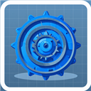

# 航空学：虚化 (Aeronautics Fade)

**没人管的物理结构会安静地淡出、消失，让服务器和存档保持轻快。**

*Abandoned physics contraptions quietly fade out and vanish — keeping your server and saves light.*

[中文](#中文) · [English](#english) · [CurseForge](https://www.curseforge.com/minecraft/mc-mods/create-aeronautics-fade) · [mcmod](https://www.mcmod.cn/class/30911.html)

---

## 中文

### 这是什么

大型存档总会悄悄堆满垃圾：做了一半的飞艇、重建过六次的测试台、某次壮烈坠毁留下的碎片场。它们每一个都还是**活的物理结构**，都在持续消耗服务器 tick、把存档撑大。

本模组替你送走它们 —— **安静到你几乎感觉不到它存在**。

### 工作方式

1. 无人互动的结构开始**逐渐变透明** —— 给玩家一个清晰的预告，而不是猝不及防地消失
2. 淡出结束后，结构被**移除**
3. **插了铭牌并写了名字的结构永远安全**

默认：空闲 **10 分钟**后开始淡出，淡出持续 **5 分钟**，也就是最后一次互动后 **15 分钟**彻底消失。全部可配置。

### 什么算「互动」

| 行为 | 默认 |
| --- | --- |
| 结构上的方块被放置或破坏 | **开启** |
| 玩家站在上面或骑在上面 | **开启** |
| 结构自身发生位移或旋转 | 关闭 |

「机械动方块」是**刻意**算作互动的：机械还在转，就说明这个结构还活着。已知反例是不需要燃料的动力源 —— 风车、水车、创造马达 —— 它们废弃了也不会停；遇到就把 `onBlockChange` 关掉，只靠「玩家站在上面」判定。

### 豁免会沿物理连接传播

物理轴承会把挂上去的部分变成**独立的子维度** —— 挖掘机的机臂、坦克的炮塔都是这样，而铭牌只命名了宿主。本模组会顺着物理连接把豁免**传染**过去，覆盖轴承、绳子、对接器、把手、弹簧、合并胶，**整台机器被当作一个整体**。

### 安装

* **服务端：必须。** 所有逻辑都在服务端 —— 计时、判定、删除结构。
* **客户端：可选。** 客户端只负责画出淡出效果。没装的玩家看到的结构会保持原样直到被删除；**原版客户端也能正常进服**（网络包是可选注册的）。

### 前置

* Minecraft **1.21.1** / NeoForge **21.1.x** / **Java 21**
* **Create**
* **Create: 航空学** —— 它自带 Sable 与 Simulated，不要单独装

### 配置

    <存档>/serverconfig/aerofade-server.toml     空闲时长、虚化时长、判定方式、质量阈值、日志
    .minecraft/config/aerofade-client.toml        渲染（enableTransparency、finalAlpha）

用 `/fade set` 修改的值会写入配置文件，**跨重启保留**。

### 指令

| 指令 | 作用 |
| --- | --- |
| `/fade status` | 查看当前配置与状态 |
| `/fade list [all\|waiting\|fading]` | 列出所有结构及其倒计时 |
| `/fade why <索引>` | 某个结构为什么不虚化 |
| `/fade set idle\|duration\|massthreshold\|interrupt ...` | 修改参数 |
| `/fade on` / `/fade off` | 总开关 |
| `/fade force fade <索引>` | 立刻让它进入虚化 |
| `/fade reset <索引\|all>` | 重置倒计时 |

需要 OP（权限等级 2）。

### 常见问题

**会不会把我的东西删了？**
写了名字就不会。放一个铭牌、写上一个名字，那个结构就永久豁免。想给还没命名的大型建筑留保险，可以设 `massThreshold` —— 质量达到阈值的结构同样豁免。

**为什么不改成「取消物理化」或「留下残骸」？**
这是呼声最高的需求，但不会采纳：

* **取消物理化不是所有情况都能做** —— 把结构还原成普通方块需要在世界里有一块合法、不冲突的空间，有些位置上装配系统本身就会拒绝；强行做会造成方块重叠、光照错乱。
* **而且它会让问题更严重** —— 取消物理化一个五千方块的建筑，等于把一个物理结构变成几千次方块更新、光照更新和碰撞检测，峰值比删除子维度大得多。
* **残骸也没有更好** —— 物品实体要逐个 tick、要合并、要写进存档，还会越堆越多。满地残骸正是本模组要避免的东西。

想保留什么，**用铭牌**。如果以后真要做取消物理化或残骸，那应该是另一个附属的内容。

**只有我装了，别人没装，能一起玩吗？**
能。服务端装了就行，没装客户端的玩家只是看不到淡出效果。

**结构被卸载了还会倒计时吗？**
不会。只有**被加载**的结构才倒计时，卸载时暂停，重新加载后接着走。

**服务器重启会重置倒计时吗？**
不会。最后一次互动时间存在存档里。

### 已知问题

使用贴图自身透明度、且走半透明层的方块 —— 例如**装了玻璃的伪装板** —— 在虚化**刚开始时会略微发暗**，之后正常淡出。纯玻璃方块不受影响（它走的是另一条渲染路径）。

这只是观感问题，**不影响结构是否被正确清理**。想完全避免，把客户端配置里的 `enableTransparency` 设为 `false`（结构会保持原样直到被删除）。

### 从源码构建

见 [DEVELOPMENT.md](DEVELOPMENT.md)。

### 协议与作者

**MIT** · BiliBili@上升_螺旋, DeepSeek-V4.1-Flash

---

## English

### What it is

Large worlds quietly fill up with junk: a half-finished airship, the test rig you rebuilt six times, the debris field from that one spectacular crash. Every one of them is still a **live physics structure**, costing you server tick time and save size.

This mod retires them for you — **so quietly you will forget it is installed**.

### How it works

1. A structure nobody interacts with starts to **fade out** — a clear warning instead of a surprise
2. When the fade finishes, the structure is **removed**
3. **Anything with a nameplate is safe forever**

By default a structure starts fading after **10 minutes** with no interaction, takes **5 minutes** to fade, and is gone **15 minutes** after you last touched it. All of it is configurable.

### What counts as "interaction"

| Action | Default |
| --- | --- |
| A block on it is placed or broken | **On** |
| A player stands on or rides it | **On** |
| The structure itself moves or rotates | Off |

Machinery counts on purpose: if the machine is still running, the structure is still alive. The known exception is fuel-free power — windmills, water wheels, creative motors — which never stop even when abandoned. For those, turn `onBlockChange` off and rely on the player-standing rule.

### Exemption spreads along physical connections

A physics bearing turns the part mounted on it into a **separate sub-level** — an excavator arm, a tank turret — while a nameplate only names the host. This mod follows the connection and **spreads the exemption** across bearings, ropes, docking connectors, handles, springs and merging glue, so **a whole machine is treated as one**.

### Installation

* **Server: required.** All logic lives server-side — timing, checks, and removing structures.
* **Client: optional.** The client only draws the fade. Without it, structures simply stay visible until they are removed, and **unmodded clients can still join** (the network payload is registered as optional).

### Requirements

* Minecraft **1.21.1** / NeoForge **21.1.x** / **Java 21**
* **Create**
* **Create: Aeronautics** — it bundles Sable and Simulated; do not install those separately

### Configuration

    <world>/serverconfig/aerofade-server.toml     idle time, fade duration, interrupts, mass threshold, logging
    .minecraft/config/aerofade-client.toml        rendering (enableTransparency, finalAlpha)

Values changed with `/fade set` are written to the config file and **survive a restart**.

### Commands

| Command | Effect |
| --- | --- |
| `/fade status` | show current config and state |
| `/fade list [all\|waiting\|fading]` | list structures and their countdowns |
| `/fade why <index>` | why a structure is (not) fading |
| `/fade set idle\|duration\|massthreshold\|interrupt ...` | change settings |
| `/fade on` / `/fade off` | master switch |
| `/fade force fade <index>` | start fading immediately |
| `/fade reset <index\|all>` | reset the countdown |

Requires OP (permission level 2).

### FAQ

**Will it delete my builds?**
Not if you name them. Place a nameplate, write a name on it, and that structure is exempt forever. For large unnamed builds, set `massThreshold` — everything at or above that mass is spared too.

**Why not un-physicalize structures or leave wreckage instead?**
This is the most requested change, and it will not be adopted:

* **Un-physicalizing is not always possible.** Turning a structure back into ordinary blocks requires a valid, collision-free volume in the world. There are positions where the assembly system itself refuses the operation, and forcing it would produce overlapping blocks and broken lighting.
* **It would make the problem worse.** Un-assembling a 5,000-block build turns one physics structure into thousands of block updates, light updates and collision checks — a far bigger spike than removing a sub-level.
* **Wreckage is no better.** Item entities tick individually, merge, get written to the save, and pile up — which is exactly what this mod exists to prevent.

If you want to keep something, **use a nameplate**. If un-physicalizing or wreckage ever happens, it belongs in a separate addon.

**Do other players need the mod?**
No. Only the server needs it. Players without it simply do not see the fade.

**Do unloaded structures count down?**
No. Only **loaded** structures count down; the timer pauses and resumes.

**Does a server restart reset the timers?**
No. The last interaction time is stored in the save.

### Known issues

Blocks that use their own texture alpha and render in the translucent layer — for example a **disguise panel fitted with glass** — **darken slightly at the very start of the fade**, then fade normally. Plain glass is unaffected (it renders through a different path).

This is cosmetic only and **never affects whether a structure is cleaned up correctly**. To avoid it entirely, set `enableTransparency = false` in the client config (structures will stay untouched until removal).

### Building from source

See [DEVELOPMENT.md](DEVELOPMENT.md).

### License & credits

**MIT** · BiliBili@上升_螺旋, DeepSeek-V4.1-Flash